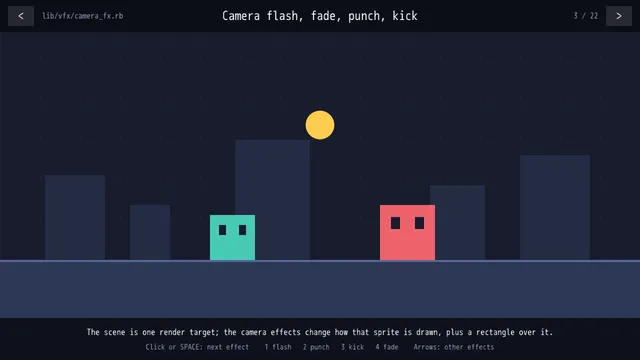

# Camera flash, fade, punch, kick



- **File:** `mygame/lib/vfx/camera_fx.rb` (`Vfx::CameraFx`)
- **Needs:** the scene drawn to a render target. Any licence tier, web builds included.
- **Cost:** one or two full-screen rectangles while a flash or fade is showing.

## What it is

Four standard camera moves in one state Hash:

- **Flash:** a full-screen burst of colour that fades away. Explosions, damage, lightning.
- **Fade:** the screen goes to a colour and comes back. Scene changes.
- **Punch:** the camera zooms in at once and eases back. Impacts.
- **Kick:** the camera is shoved in a direction and eases back. Recoil, a blow's direction.

## Use

```ruby
require "lib/vfx/camera_fx.rb"

def tick(args)
  cam = args.state.cam ||= Vfx::CameraFx.new
  keys = args.inputs.keyboard.key_down
  Vfx::CameraFx.flash(cam) if keys.one
  Vfx::CameraFx.punch(cam, 0.08) if keys.two
  Vfx::CameraFx.kick(cam, 180, 24) if keys.three      # shoved to the left
  Vfx::CameraFx.fade_out(cam) if keys.four
  Vfx::CameraFx.fade_in(cam) if keys.five
  Vfx::CameraFx.tick(cam)

  scene = args.outputs[:scene]
  scene.w = 1280
  scene.h = 720
  scene.primitives << { x: 600, y: 320, w: 80, h: 80, path: :solid, r: 255, g: 200, b: 80 }

  args.outputs.primitives << Vfx::CameraFx.sprite(cam, :scene)   # the scene, zoomed and kicked
  args.outputs.primitives << Vfx::CameraFx.overlay(cam)          # flash and fade rectangles
end
```

## API

| Call | Does |
|---|---|
| `Vfx::CameraFx.new` | Returns the state Hash |
| `Vfx::CameraFx.flash(cam, frames: 14, color: [255, 255, 255], strength: 0.9)` | Starts a flash. `strength` 1 is opaque |
| `Vfx::CameraFx.fade(cam, to:, frames: 30, color: [0, 0, 0])` | Moves the fade towards `to`: 1 covers the screen, 0 clears it |
| `Vfx::CameraFx.fade_out(cam, frames: 30, color: [0, 0, 0])` | `fade` to 1 |
| `Vfx::CameraFx.fade_in(cam, frames: 30)` | `fade` to 0, keeping the colour |
| `Vfx::CameraFx.fading?(cam)` | true while a fade is moving |
| `Vfx::CameraFx.punch(cam, amount = 0.06, frames: 16)` | Zooms in by `amount` (0.06 is 6%) and eases back |
| `Vfx::CameraFx.kick(cam, angle, distance = 14, frames: 12)` | Shoves `distance` pixels towards `angle` degrees (0 right, 90 up) |
| `Vfx::CameraFx.tick(cam)` | Once a frame |
| `Vfx::CameraFx.sprite(cam, path, w: 1280, h: 720, shake: { x: 0, y: 0, angle: 0 })` | The render target as a screen sprite |
| `Vfx::CameraFx.overlay(cam, w: 1280, h: 720)` | Array of rectangles to draw over the scene; may be empty |

State keys you can read: `:zoom`, `:x`, `:y`, `:fade_alpha` (0 to 1).

## Notes

- To change scene on a fade: call `fade_out`, and when `fade_alpha` is 1 and `fading?` is false, swap the scene and call `fade_in`.
- `sprite` takes `shake:` with any Hash that has `:x`, `:y` and `:angle`, which is what `Vfx::Shake` produces, so the two combine without either file needing the other.
- A new flash, punch or kick replaces one still running; they do not add up.
- A kick moves the scene and shows what lies beyond its edge. Draw the render target larger than the screen, or keep kicks short.
- Full-screen white flashes can trigger photosensitive seizures. Keep them brief, lower `strength`, and offer a setting to turn them off.

## Source

Phaser's camera effects and HaxeFlixel's `FlxCamera` (both MIT) define the
vocabulary. Written from scratch.
