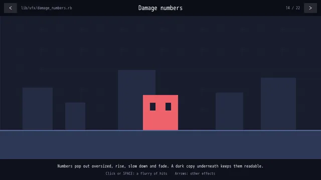

# Damage numbers



- **File:** `mygame/lib/vfx/damage_numbers.rb` (`Vfx::DamageNumbers`)
- **Needs:** nothing. Any licence tier, web builds included.
- **Cost:** two labels per number on screen.

## What it is

Text that pops out of a hit oversized, rises, slows and fades: the floating
combat text of action RPGs. A dark copy under each number keeps it readable
over any background.

## Use

```ruby
require "lib/vfx/damage_numbers.rb"

def tick(args)
  numbers = args.state.numbers ||= Vfx::DamageNumbers.new
  mouse = args.inputs.mouse
  if mouse.click
    Vfx::DamageNumbers.pop(numbers, x: mouse.x, y: mouse.y, text: 5 + rand(20))
  end
  if args.inputs.keyboard.key_down.space
    Vfx::DamageNumbers.pop(numbers, x: 640, y: 360, text: "48!", size: 52, color: [255, 204, 77], rise: 4.2)
  end
  Vfx::DamageNumbers.tick(numbers)
  args.outputs.background_color = [40, 44, 70]
  args.outputs.primitives << Vfx::DamageNumbers.labels(numbers)
end
```

## API

| Call | Does |
|---|---|
| `Vfx::DamageNumbers.new` | Returns the state Hash |
| `Vfx::DamageNumbers.pop(numbers, x:, y:, text:, color: [255, 255, 255], size: 30, life: 55, rise: 3.2, drift: 1.0, gravity: 0.07)` | Adds a number |
| `Vfx::DamageNumbers.tick(numbers, time_scale = 1.0)` | Once a frame |
| `Vfx::DamageNumbers.labels(numbers)` | The labels to draw, two per number |

| `pop` option | Meaning |
|---|---|
| `text` | Anything; shown with `to_s` |
| `size` | Height in pixels once settled; it is born at 1.6 times that |
| `life` | Frames. It fades over the last 40% |
| `rise` | Speed upwards at birth, in pixels per frame |
| `drift` | The most it may wander sideways per frame; each number picks its own |
| `gravity` | How fast the rise slows. Above `rise / life` the number falls back before it fades |

## Notes

- Tell kinds apart by colour and size: white for ordinary, large yellow for criticals, green for healing, grey for a miss.
- Spread the start positions a little so numbers from the same blow do not stack.
- Pass the hit stop's time scale to `tick` and the numbers hold with the game.
- The labels use the engine's default font; add `font:` to each label for your own.

## Source

A long-standing convention of action RPGs. Written from scratch.
