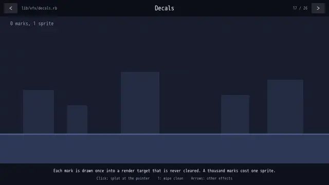

# Decals



- **File:** `mygame/lib/vfx/decals.rb` (`Vfx::Decals`)
- **Needs:** nothing. Any licence tier, web builds included.
- **Cost:** one screen-sized render target, and one sprite to show it, however many marks it holds.

## What it is

Marks that stay: scorches, blood, footprints, skid marks, paint. Each mark is
drawn once into a render target that is never cleared, and from then on costs
nothing. Put the layer between the ground and whatever walks on it.

## Use

```ruby
require "lib/vfx/decals.rb"

def tick(args)
  decals = args.state.decals ||= Vfx::Decals.new
  mouse = args.inputs.mouse
  if mouse.click
    Vfx::Decals.stamp(decals, { x: mouse.x - 20, y: mouse.y - 20, w: 40, h: 40,
                                path: "lib/vfx/sprites/circle.png", r: 239, g: 98, b: 108, a: 200 })
  end
  Vfx::Decals.clear(decals) if args.inputs.keyboard.key_down.space

  args.outputs.background_color = [40, 44, 70]
  args.outputs.primitives << Vfx::Decals.draw(args.outputs, decals)
end
```

## API

| Call | Does |
|---|---|
| `Vfx::Decals.new` | Returns the state Hash |
| `Vfx::Decals.stamp(decals, sprite)` | Queues a sprite, or an array of them, for the layer |
| `Vfx::Decals.clear(decals)` | Empties the layer at the next draw |
| `Vfx::Decals.draw(outputs, decals, target: :vfx_decals, w: 1280, h: 720)` | Once a frame. Draws the queued marks and returns the sprite that shows the layer |

## Notes

- The picture lives in the engine, not in the state: it does not survive a restart, a save or `DR.reset`. Keep your own list of marks if they must.
- The layer is the size of the screen. For a world larger than that, use one layer per screen-sized chunk with its own `target:`, and stamp in that chunk's coordinates.
- Marks cannot be removed one at a time, only all together. To fade old marks, stamp a faint rectangle of the ground's colour over the whole layer now and then.
- Call `draw` every frame, even when nothing was stamped.

## Source

The persistent splat map of top-down shooters such as Nuclear Throne;
DragonRuby's own sample shows a render target that is not cleared. Written
from scratch.
