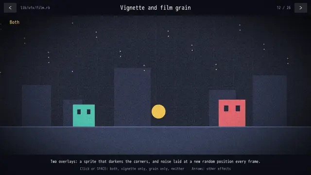

# Vignette and film grain



- **File:** `mygame/lib/vfx/film.rb` (`Vfx::Film`)
- **Needs:** `sprites/vfx/vignette.png` and `sprites/vfx/grain.png`. Any licence tier, web builds included.
- **Cost:** one sprite for the vignette; about 24 for the grain at the default tile size.

## What it is

Two overlays. The vignette darkens the corners and pulls the eye to the
middle. Grain is a picture of noise laid over the screen at a new random
position every frame, so flat colours shimmer like film.

## Use

```ruby
require "lib/vfx/film.rb"

def tick(args)
  args.outputs.background_color = [70, 90, 130]
  args.outputs.primitives << { x: 560, y: 280, w: 160, h: 160, path: :solid, r: 72, g: 202, b: 180 }

  args.outputs.primitives << Vfx::Film.grain(strength: 0.12)
  args.outputs.primitives << Vfx::Film.vignette(strength: 0.8)
end
```

## API

| Call | Does |
|---|---|
| `Vfx::Film.vignette(strength: 0.6, color: [0, 0, 0], w: 1280, h: 720)` | One sprite over the screen. 0 nothing, 1 fully dark corners |
| `Vfx::Film.grain(strength: 0.1, tile: 256, w: 1280, h: 720)` | Tiles of noise, shifted at random on every call |

There is no state.

## Notes

- A red vignette whose strength follows missing health is the usual low-health warning; pulse it with a sine.
- Grain strength 0.05 to 0.1 is felt more than seen; 0.25 is an old film.
- A larger `tile` gives coarser grain and fewer sprites.
- The same 256-pixel noise repeats across the screen. The random shift hides it in motion; it can show in a still.
- The grain here lightens and darkens by plain alpha, which also greys the picture slightly at high strength.
- Draw both before the HUD if text should stay clean.

## Source

moonshine's `vignette` and `filmgrain` and pixi-filters' `OldFilmFilter` (all
MIT) do this in a shader. The sprite version is written from scratch.
