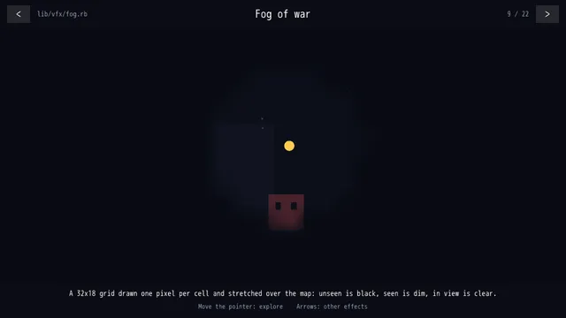

# Fog of war



- **File:** `mygame/lib/vfx/fog.rb` (`Vfx::Fog`)
- **Needs:** nothing. Any licence tier, web builds included.
- **Cost:** one pass over the grid per frame in Ruby, and up to one tiny rectangle per cell. A 32x18 grid is 576 cells.

## What it is

The map is a grid. A cell is unseen (black), seen before (dimmed) or in view
now (clear). The fog is drawn one pixel per cell into a tiny render target and
stretched over the map, so the engine's smoothing turns the hard grid into
soft edges for free.

## Use

```ruby
require "lib/vfx/fog.rb"

def tick(args)
  fog = args.state.fog ||= Vfx::Fog.new(columns: 32, rows: 18, cell: 40)
  mouse = args.inputs.mouse

  Vfx::Fog.reveal(fog, mouse.x, mouse.y, 170)   # once per unit that can see
  Vfx::Fog.tick(fog)

  args.outputs.background_color = [60, 90, 70]
  enemy = { x: 900, y: 300, w: 60, h: 60, path: :solid, r: 239, g: 98, b: 108 }
  args.outputs.primitives << enemy if Vfx::Fog.visible?(fog, 930, 330)
  args.outputs.primitives << Vfx::Fog.draw(args.outputs, fog)
end
```

Every frame: every `reveal`, then `tick`, then `draw`.

## API

| Call | Does |
|---|---|
| `Vfx::Fog.new(columns:, rows:, cell:, x: 0, y: 0, dim: 150, speed: 0.15)` | Returns the state Hash |
| `Vfx::Fog.reveal(fog, x, y, radius)` | Marks the cells whose centre is within `radius` pixels as in view this frame. Use a radius of a cell or more |
| `Vfx::Fog.tick(fog)` | Once a frame, after the reveals |
| `Vfx::Fog.visible?(fog, x, y)` | Is the point in view right now? |
| `Vfx::Fog.seen?(fog, x, y)` | Has it ever been in view? |
| `Vfx::Fog.draw(outputs, fog, color: [8, 10, 18], target: :vfx_fog)` | Builds the fog and returns the sprite that lays it over the map |

| Parameter | Meaning |
|---|---|
| `columns`, `rows`, `cell` | The grid, and the side of a cell in pixels |
| `x`, `y` | The bottom-left corner of the map on screen |
| `dim` | How dark a seen-before cell is, 0 to 255. 0 means explored land stays clear |
| `speed` | How fast cells change, 0 to 1. 1 is instant |

## Notes

- Smaller cells give a rounder edge and cost more; the cell does not have to match your tile size.
- For a scrolling map, keep the fog the size of the whole map and move `fog[:x]`, `fog[:y]` with the camera.
- `fog[:cells]` is a flat list of cells, row by row from the bottom; each has `:seen`. Save those with the game.
- Sight is a plain circle; walls do not block it.

## Source

raylib's `textures_fog_of_war` example (zlib) for the small-texture trick.
Written from scratch.
