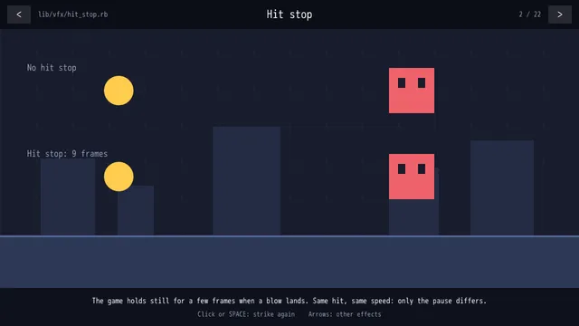

# Hit stop



- **File:** `mygame/lib/vfx/hit_stop.rb` (`Vfx::HitStop`)
- **Needs:** nothing. Any licence tier, web builds included.
- **Cost:** one comparison per frame.

## What it is

When a blow lands, the game holds still for a few frames, then carries on.
The pause gives the hit weight: the eye reads the contact before anything
flies off. Also called freeze frames or hit pause. The same state can run the
game in slow motion for a while.

## Use

```ruby
require "lib/vfx/hit_stop.rb"

def tick(args)
  args.state.stop ||= Vfx::HitStop.new
  args.state.x ||= 0

  Vfx::HitStop.freeze(args.state.stop, 8) if args.inputs.keyboard.key_down.space
  scale = Vfx::HitStop.tick(args.state.stop)   # 0.0 while frozen, 1.0 otherwise

  args.state.x = (args.state.x + (6 * scale)) % 1280   # movement multiplied by the scale
  args.outputs.primitives << { x: args.state.x, y: 320, w: 80, h: 80, path: :solid, r: 255, g: 200, b: 80 }
end
```

Keep drawing while frozen; only the update stops.

## API

| Call | Does |
|---|---|
| `Vfx::HitStop.new` | Returns the state Hash |
| `Vfx::HitStop.freeze(stop, frames)` | Holds the game for `frames`. A longer freeze already running is kept |
| `Vfx::HitStop.slow(stop, frames, scale = 0.3)` | Runs at `scale` speed for `frames`, after any freeze |
| `Vfx::HitStop.tick(stop)` | Once a frame. Returns the time scale and stores it in `stop[:scale]` |
| `Vfx::HitStop.frozen?(stop)` | true while frames of freeze remain |

Typical lengths at 60 frames per second: 3-5 for a light hit, 6-10 for a heavy
one, 15 or more for a kill or a boss's last blow.

## Notes

- Stillness alone can read as a stutter. While frozen, flash the target white and tremble it a pixel or two, as the gallery demo does.
- Freeze only what took part if the rest of the screen should keep moving: give the attacker and the target their own state.
- Do not multiply timers the player depends on (input buffers, music) by the scale.

## Source

Jan Willem Nijman (Vlambeer), "The Art of Screenshake" (2013). Written from
scratch.
