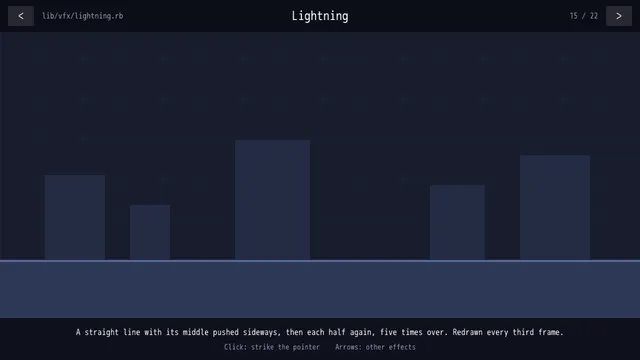

# Lightning



- **File:** `mygame/lib/vfx/lightning.rb` (`Vfx::Lightning`)
- **Needs:** nothing. Any licence tier, web builds included.
- **Cost:** two additive sprites per piece: 64 for a default bolt, more with branches.

## What it is

A jagged bolt between two points. Take the straight line, push its middle
sideways by a random amount, do the same to each half, and repeat: midpoint
displacement. `bolt` returns the pieces and `sprites` draws them as a thin
bright core inside a wide faint glow.

A bolt is a still picture. Make a new one every two or three frames while the
strike lasts and it crackles.

## Use

```ruby
require "lib/vfx/lightning.rb"

def tick(args)
  args.state.strike ||= 0
  mouse = args.inputs.mouse
  args.state.strike = 15 if mouse.click
  args.outputs.background_color = [20, 22, 36]
  return if args.state.strike <= 0

  args.state.strike -= 1
  # A new seed every third frame: a new bolt between the same two points.
  pieces = Vfx::Lightning.bolt(640, 720, mouse.x, mouse.y, seed: args.state.strike.idiv(3))
  args.outputs.primitives << Vfx::Lightning.sprites(pieces, alpha: 255 * args.state.strike / 15.0)
end
```

## API

| Call | Does |
|---|---|
| `Vfx::Lightning.bolt(x1, y1, x2, y2, jagged: 0.22, detail: 5, branches: 0.25, seed: nil)` | Returns the pieces: Hashes with `x1, y1, x2, y2` and `weight` |
| `Vfx::Lightning.sprites(pieces, width: 4, color: [190, 220, 255], alpha: 255)` | Two additive lines per piece |

| Parameter | Meaning |
|---|---|
| `jagged` | How far a middle is pushed, as a fraction of its piece. 0.1 nearly straight, 0.35 wild |
| `detail` | How many times pieces are halved. 5 gives 32 pieces; 0 gives one straight line |
| `branches` | The chance, 0 to 1, that a joint grows a side bolt at half the weight |
| `seed` | A whole number for the same bolt every time; leave out for a new one each call |

## Notes

- For a continuous arc between two things (a beam, a tesla coil), call `bolt` with no seed every frame or two.
- A brief full-screen tint and a glow at the point of impact, as in the gallery demo, do most of the work of selling the strike.
- The pieces are plain data: test a point against them for a hit, or feed them to particles for sparks.

## Source

Midpoint displacement, as in Michael Hoffman's "How to Generate Shockingly
Good 2D Lightning Effects" (2013). Written from scratch.
