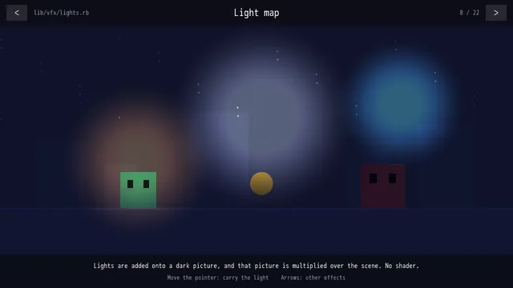

# Light map



- **File:** `mygame/lib/vfx/lights.rb` (`Vfx::Lights`)
- **Needs:** `sprites/vfx/light.png`. Any licence tier, web builds included.
- **Cost:** one screen-sized render target and one sprite per light.

## What it is

2D lighting without a shader. A second picture the size of the screen starts
as the ambient colour, the darkness. Each light is a soft white sprite added
onto it. That picture is then multiplied over the scene: dark where no light
reaches, the scene's own colours where one does, tinted by the light.

## Use

```ruby
require "lib/vfx/lights.rb"

def tick(args)
  mouse = args.inputs.mouse
  lights = [{ x: mouse.x, y: mouse.y, radius: 240 },
            { x: 900, y: 300, radius: 160 * Vfx::Lights.flicker(Kernel.tick_count), r: 255, g: 150, b: 60 }]

  args.outputs.background_color = [150, 160, 190]
  args.outputs.primitives << { x: 560, y: 280, w: 160, h: 160, path: :solid, r: 72, g: 202, b: 180 }
  args.outputs.primitives << Vfx::Lights.draw(args.outputs, lights, ambient: [20, 22, 40])
  # anything drawn from here on (the HUD) is not darkened
end
```

## API

| Call | Does |
|---|---|
| `Vfx::Lights.draw(outputs, lights, ambient: [24, 26, 44], target: :vfx_lights, w: 1280, h: 720, extra: [])` | Builds the light map and returns the sprite that lays it over the scene |
| `Vfx::Lights.sprites(lights, path: "sprites/vfx/light.png")` | The additive sprites alone, if you manage the render target yourself |
| `Vfx::Lights.flicker(clock, seed: 0, amount: 0.06)` | A number wandering around 1, for a torch's radius |

A light is a Hash:

| Key | Meaning |
|---|---|
| `x`, `y` | Its centre |
| `radius` | Where its glow ends, in pixels |
| `r`, `g`, `b` | Its colour. White if left out |
| `a` | Its strength, up to 255. Full if left out |

## Notes

- `ambient: [0, 0, 0]` is pitch black; a dark blue reads as night; a mid grey as dusk.
- A light can only show the scene as bright as it was drawn. Light a dark scene and it stays dark.
- Lights that overlap add up and can wash out towards white; lower `a` where many meet.
- This gives glow, not shadows: walls do not block light. For shadow casting see xenobrain's `ruby-shadowcasting`.
- Give each torch its own `seed:` in `flicker` so they do not pulse together.
- `extra:` takes additive sprites to add to the map as they are, such as the shadow-casting lights from `shadows.rb`.

## Source

Godot's 2D light demos (MIT) and DragonRuby's own lighting sample for the
render-target approach. Written from scratch.
