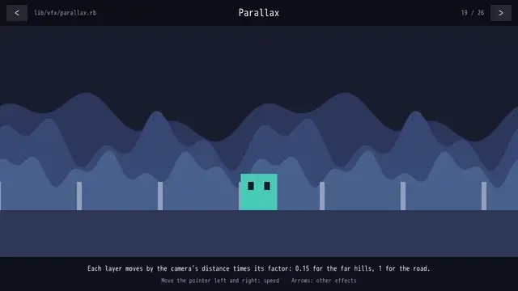

# Parallax



- **File:** `mygame/lib/vfx/parallax.rb` (`Vfx::Parallax`)
- **Needs:** your own layer pictures, each able to repeat sideways. Any licence tier, web builds included.
- **Cost:** enough copies of each layer to cover the screen: three or four per layer.

## What it is

Background layers that scroll slower the further away they are. Each layer has
a factor: 0 never moves (the sky), 1 moves with the camera (the ground the
hero stands on), and anything between looks that far away.

## Use

```ruby
require "lib/vfx/parallax.rb"

LAYERS = [{ path: "sprites/mountains.png", w: 640, h: 360, y: 200, factor: 0.15 },
          { path: "sprites/hills.png",     w: 640, h: 300, y: 200, factor: 0.4 },
          { path: "sprites/trees.png",     w: 640, h: 260, y: 200, factor: 0.7, r: 200, g: 220, b: 255 }]

def tick(args)
  args.state.camera_x ||= 0
  args.state.camera_x += args.inputs.left_right * 6
  args.outputs.primitives << Vfx::Parallax.sprites(LAYERS, args.state.camera_x)
end
```

## API

| Call | Does |
|---|---|
| `Vfx::Parallax.sprites(layers, camera_x, screen_w: 1280)` | The sprites for every layer, far to near |

A layer is a Hash:

| Key | Meaning |
|---|---|
| `path` | The picture. Its left and right edges must match for it to repeat |
| `w`, `h` | The size one copy is drawn at |
| `y` | Where its bottom edge sits |
| `factor` | How much of the camera's movement it follows, 0 to 1. Above 1 for things in front of the hero |
| anything else | Passed to the sprite: `r`, `g`, `b`, `a`, `blendmode` |

There is no state.

## Notes

- List layers far to near; that is the order they are drawn in.
- Tint far layers towards the sky's colour and they recede further.
- For vertical parallax, add `camera_y * factor` to each returned sprite's `y`.
- A layer that drifts by itself (clouds) is `camera_x + clock * speed` for that layer.

## Source

Parallax scrolling, in games since Moon Patrol (1982). Written from scratch.
