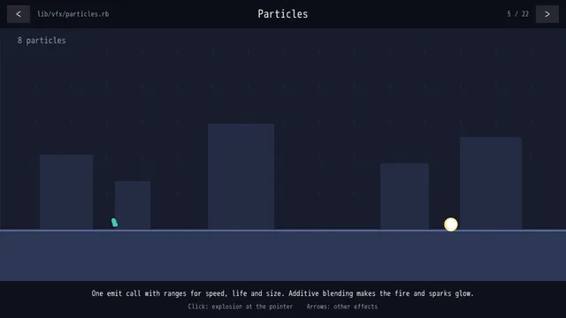

# Particles



- **File:** `mygame/lib/vfx/particles.rb` (`Vfx::Particles`)
- **Needs:** `sprites/vfx/circle.png`, or your own sprite passed as `path:`. Any licence tier, web builds included.
- **Cost:** one Hash per particle, updated in Ruby every frame. Hundreds are cheap; measure before going into the thousands. `max:` caps the count.

## What it is

Bursts and streams of small sprites that move, slow, fall, shrink, change
colour and fade. One call, `emit`, covers explosions, sparks, smoke, fire,
fountains and dust; the difference is only in the numbers. A value that should
vary between particles takes a Range.

## Use

```ruby
require "lib/vfx/particles.rb"

def tick(args)
  sparks = args.state.sparks ||= Vfx::Particles.new
  if args.inputs.mouse.click
    Vfx::Particles.emit(sparks, x: args.inputs.mouse.x, y: args.inputs.mouse.y, count: 40,
                                speed: 2..9, life: 20..45, size: 6..14,
                                color: [255, 235, 150], color_end: [255, 70, 30],
                                gravity: 0.15, drag: 0.96, blendmode: 2)
  end
  Vfx::Particles.tick(sparks)
  args.outputs.background_color = [20, 22, 36]
  args.outputs.primitives << Vfx::Particles.sprites(sparks)
end
```

## API

| Call | Does |
|---|---|
| `Vfx::Particles.new(max: 1000)` | Returns the state Hash. Beyond `max` the oldest particles are dropped |
| `Vfx::Particles.emit(emitter, x:, y:, ...)` | Adds particles; options below |
| `Vfx::Particles.tick(emitter, time_scale = 1.0)` | Once a frame: moves, ages and removes them |
| `Vfx::Particles.sprites(emitter)` | The live particles, as sprite Hashes |
| `Vfx::Particles.count(emitter)` | How many are alive |

| `emit` option | Default | Meaning |
|---|---|---|
| `count` | 1 | How many to add |
| `angle`, `spread` | 90, 360 | Direction in degrees (90 is up) and the width of the cone |
| `speed` | 3 | Pixels per frame. Number or Range |
| `life` | 40 | Frames. Number or Range |
| `size`, `size_end` | 10, 0 | Diameter at birth (Number or Range) and at death |
| `color`, `color_end` | `[255, 255, 255]`, `nil` | `[r, g, b]` at birth and at death; `nil` keeps the colour |
| `alpha` | 255 | Opacity at birth; always fades to 0 |
| `gravity` | 0 | Pulled down this much per frame; negative rises |
| `drag` | 1.0 | Fraction of speed kept each frame |
| `spin` | 0 | Degrees per frame. Number or Range |
| `path` | `"sprites/vfx/circle.png"` | The sprite to draw |
| `blendmode` | 1 | 1 normal; 2 additive, for anything that glows |

## Recipes

| Look | Options |
|---|---|
| Explosion sparks | `count: 50, speed: 2..10, life: 20..48, size: 6..16, color_end: red, gravity: 0.15, drag: 0.96, blendmode: 2` |
| Smoke | `count: 14, speed: 0.5..2, life: 50..80, size: 24..40, size_end: 80, alpha: 110, gravity: -0.02` |
| Torch (every frame) | `count: 2, spread: 50, speed: 1..3, life: 25..45, size: 20..34, size_end: 2, gravity: -0.04, blendmode: 2` |
| Fountain (every frame) | `count: 2, spread: 22, speed: 9..12, life: 60..80, gravity: 0.22` |

## Notes

- For a continuous effect, call `emit` every frame with a small `count`.
- A particle is the sprite Hash itself, changed in place, so `sprites` allocates nothing.
- Pass the hit stop's time scale to `tick` and the particles freeze with the game, keeping their speed.

## Source

HaxeFlixel's `FlxEmitter` and LittleJS's `ParticleEmitter` (both MIT) for the
set of options. Written from scratch.
