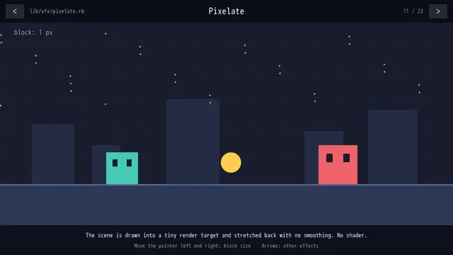

# Pixelate



- **File:** `mygame/lib/vfx/pixelate.rb` (`Vfx::Pixelate`)
- **Needs:** the scene drawn to a render target. Any licence tier, web builds included.
- **Cost:** one small extra render target.

## What it is

A mosaic without a shader. The scene is drawn into a much smaller render
target, and that small picture is stretched back over the screen with no
smoothing, so each of its pixels becomes a big square.

## Use

```ruby
require "lib/vfx/pixelate.rb"

def tick(args)
  scene = args.outputs[:scene]
  scene.w = 1280
  scene.h = 720
  scene.primitives << { x: 560, y: 280, w: 160, h: 160, path: :solid, r: 255, g: 204, b: 77, angle: 30 }

  size = 1 + (args.inputs.mouse.x / 1280.0 * 47)     # 1 is sharp
  args.outputs.primitives << Vfx::Pixelate.draw(args.outputs, :scene, size.round)
end
```

## API

| Call | Does |
|---|---|
| `Vfx::Pixelate.draw(outputs, path, size, target: :vfx_pixelate, w: 1280, h: 720)` | Returns the sprite to draw. `size` is the side of a block in screen pixels; 1 or less returns the scene untouched |
| `Vfx::Pixelate.grid(size, w, h)` | `[columns, rows]` of blocks for a size above 1 |

There is no state: keep your own number.

## Notes

- As a transition: raise the size to about 40, swap the scene, lower it again.
- Whole numbers for `size` avoid a shimmer while it animates.
- The blocks are stretched to fill the screen exactly, so they are only near `size` when it does not divide the screen: 100 on 1280x720 gives 13x8 blocks of about 98x90.
- To pixelate only part of the screen (a censor bar, one character), draw that part to its own render target and pass a different `target:` for each use in the same frame.
- Each block takes its colour from a sample of the scene, not a true average, so thin lines can flicker as they move.

## Source

moonshine's `pixelate` and Phaser's `Pixelate` filter (both MIT) do this in a
shader. The render-target version is written from scratch.
