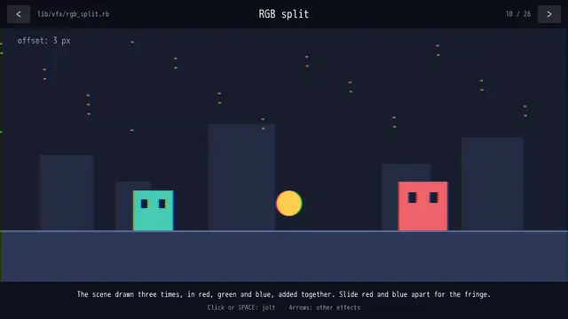

# RGB split



- **File:** `mygame/lib/vfx/rgb_split.rb` (`Vfx::RgbSplit`)
- **Needs:** the scene drawn to a render target. Any licence tier, web builds included.
- **Cost:** the scene is drawn three times instead of once.

## What it is

Chromatic aberration without a shader. The scene is drawn once in red, once
in green and once in blue, and the three are added together. Lined up they
give back the original picture; slid apart, every edge grows a red and a blue
fringe.

## Use

```ruby
require "lib/vfx/rgb_split.rb"

def tick(args)
  args.state.jolt ||= 0.0
  args.state.jolt = 1.0 if args.inputs.keyboard.key_down.space
  args.state.jolt *= 0.9

  scene = args.outputs[:scene]
  scene.w = 1280
  scene.h = 720
  scene.primitives << { x: 560, y: 280, w: 160, h: 160, path: :solid, r: 255, g: 255, b: 255 }

  args.outputs.primitives << Vfx::RgbSplit.sprites(:scene, args.state.jolt * 24)
end
```

## API

| Call | Does |
|---|---|
| `Vfx::RgbSplit.sprites(path, offset, angle: 0, x: 0, y: 0, w: 1280, h: 720)` | A black backdrop and the three coloured copies of the render target `path`, in drawing order |

| Parameter | Meaning |
|---|---|
| `offset` | How far red and blue slide, in pixels, in opposite directions. 0 is the plain picture |
| `angle` | The direction of the slide, in degrees |

There is no state: keep your own number and let it decay.

## Notes

- It shows on bright edges against dark, and hardly at all on flat or grey areas.
- 2 to 4 pixels held constantly gives a cheap lens look; 15 to 30 for a few frames is a hit or a glitch.
- The result is opaque (it sits on a black backdrop), so use it on a whole scene, not on a sprite with transparent parts.
- The slid copies leave a coloured strip at the screen's edge. Draw the scene a little larger than the screen if that shows.
- Drive `offset` with `Vfx::Shake`'s `:amount` and the two effects move together.

## Source

pixi-filters' `RGBSplitFilter` and moonshine's `chromasep` (both MIT) do this
in a shader. The three-pass version is written from scratch.
