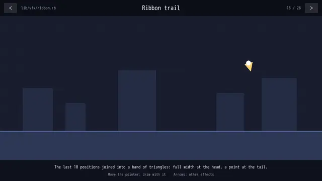

# Ribbon trail



- **File:** `mygame/lib/vfx/ribbon.rb` (`Vfx::Ribbon`)
- **Needs:** nothing. Any licence tier, web builds included.
- **Cost:** two triangles per remembered position: 34 with the defaults.

## What it is

A smooth, tapering streak behind a moving point. The ribbon remembers where
the point has been and joins those places into a band of triangles, full width
at the head and a point at the tail, fading as it goes. Sword swings,
projectiles, a cursor.

It differs from the afterimage trail, which leaves separate copies of a whole
sprite: a ribbon is one continuous shape behind a single point.

## Use

```ruby
require "lib/vfx/ribbon.rb"

def tick(args)
  ribbon = args.state.ribbon ||= Vfx::Ribbon.new
  mouse = args.inputs.mouse
  Vfx::Ribbon.tick(ribbon, mouse.x, mouse.y)
  args.outputs.background_color = [20, 22, 36]
  args.outputs.primitives << Vfx::Ribbon.sprites(ribbon, color: [255, 204, 77], blendmode: 2)
end
```

## API

| Call | Does |
|---|---|
| `Vfx::Ribbon.new(length: 18, width: 26)` | Returns the state Hash. `length` is how many positions are kept; `width` is at the head, in pixels |
| `Vfx::Ribbon.tick(ribbon, x = nil, y = nil)` | Once a frame, with where the point is. Without a position the ribbon runs out |
| `Vfx::Ribbon.sprites(ribbon, color: [255, 255, 255], alpha: 230, blendmode: 1)` | The triangles to draw |
| `Vfx::Ribbon.edges(ribbon)` | The two sides of the band at each position, if you want to draw it your own way |

## Notes

- For a sword, feed it the tip of the blade only while the swing lasts, then call `tick` with nothing.
- `blendmode: 2` (additive) makes it glow on a dark scene.
- A point that jumps a long way in one frame makes a long straight stretch; feed it in-between positions if that shows.
- Sharp reversals can fold the band over itself for a frame. A shorter `length` hides it.

## Source

The triangle-strip swipe trail found in every engine's "trail renderer".
Written from scratch.
