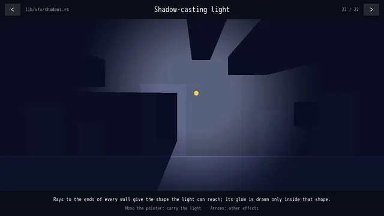

# Shadow-casting light



- **File:** `mygame/lib/vfx/shadows.rb` (`Vfx::Shadows`)
- **Needs:** `sprites/light.png` beside the file. Any licence tier, web builds included.
- **Cost:** per light, three rays for every wall end, each tested against every wall, in Ruby. 20 walls is about 3,000 tests a frame. One render target per light.

## What it is

A light that walls block. From the light, a ray is cast at each end of every
wall, and a hair to each side of it. Where the rays stop, joined in order
around the light, is the shape of everything the light can reach: the
visibility polygon. The glow is drawn only inside that shape.

The same shape answers what a guard can see, and `sees?` answers it for one
point.

## Use

```ruby
require "lib/vfx/shadows.rb"

WALLS = [[400, 250, 400, 450], [400, 450, 560, 450], [800, 200, 900, 380]]   # [x1, y1, x2, y2]

def tick(args)
  mouse = args.inputs.mouse
  lamp = { x: mouse.x, y: mouse.y, radius: 380, r: 255, g: 236, b: 200 }

  args.outputs.background_color = [14, 16, 30]
  args.outputs.primitives << Vfx::Shadows.light(args.outputs, lamp, WALLS)
  args.outputs.primitives << WALLS.map { |x1, y1, x2, y2| { x: x1, y: y1, x2: x2, y2: y2, r: 200, g: 210, b: 240, primitive_marker: :line } }
end
```

With `lights.rb`, put the result in the light map so the scene's own colours show:

```ruby
glow = Vfx::Shadows.light(args.outputs, lamp, WALLS)
args.outputs.primitives << Vfx::Lights.draw(args.outputs, other_lights, extra: [glow])
```

## API

| Call | Does |
|---|---|
| `Vfx::Shadows.light(outputs, light, walls, target: :vfx_shadow_light)` | Builds the light and returns the additive sprite that shows it |
| `Vfx::Shadows.polygon(x, y, walls, radius)` | The visibility polygon's points, in order, as `[x, y]` pairs |
| `Vfx::Shadows.sees?(x, y, px, py, walls)` | Can the second point be seen from the first? |
| `Vfx::Shadows.cast(x, y, dx, dy, walls)` | Where a ray first meets a wall |

A light is a Hash with `x`, `y`, `radius` and, if wanted, `r`, `g`, `b`. A wall is `[x1, y1, x2, y2]`.

## Notes

- Give each shadow-casting light its own `target:`.
- Pass only the walls near the light. Walls wholly outside its radius change nothing and still cost.
- A box is four walls. Walls that share an end are fine.
- The shadows are hard-edged. For softer ones, draw two or three lights a few pixels apart at a third of the strength each.
- A light placed exactly on a wall gives a ragged shape; keep lights a pixel clear.
- Keep the count of such lights small: this is the most expensive effect in the library.

## Source

The visibility polygon, as explained by Nicky Case's "Sight & Light" and Red
Blob Games' "2D Visibility". Written from scratch.
