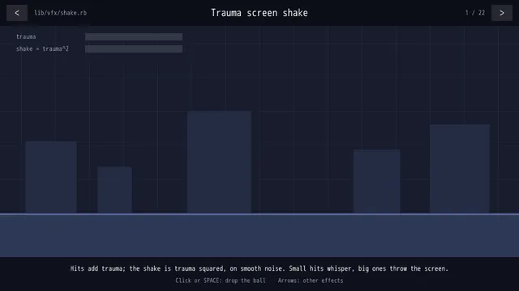

# Trauma screen shake



- **File:** `mygame/lib/vfx/shake.rb` (`Vfx::Shake`)
- **Needs:** nothing. Any licence tier, web builds included.
- **Cost:** a few sines per frame; nothing is allocated except the sprite copy in `apply`.

## What it is

Hits add *trauma*, a number from 0 to 1 that drains at a steady rate. The
shake is trauma raised to a power (squared by default), so a small hit barely
moves the screen and a big one throws it. The offsets and the tilt come from
smooth noise sampled over time, so the screen sways along a continuous path
instead of jumping to a random spot each frame.

## Use

```ruby
require "lib/vfx/shake.rb"

def tick(args)
  args.state.shake ||= Vfx::Shake.new
  Vfx::Shake.add(args.state.shake, 0.4) if args.inputs.keyboard.key_down.space
  Vfx::Shake.tick(args.state.shake)

  scene = args.outputs[:scene]          # draw the world to a render target
  scene.w = 1280
  scene.h = 720
  scene.primitives << { x: 600, y: 320, w: 80, h: 80, path: :solid, r: 255, g: 200, b: 80 }

  # 5% larger than the screen: enough to hide the edges in small shakes
  args.outputs.primitives << Vfx::Shake.apply(args.state.shake, { x: -32, y: -18, w: 1344, h: 756, path: :scene })
end
```

Draw the HUD after the scene sprite and it stays still while the world shakes.

## API

| Call | Does |
|---|---|
| `Vfx::Shake.new(max_x: 28, max_y: 28, max_angle: 3.0, decay: 1.0, speed: 0.4, power: 2, seed: 0)` | Returns the state Hash |
| `Vfx::Shake.add(shake, amount)` | Adds trauma, capped at 1. 0.2 a tap, 0.5 a solid hit |
| `Vfx::Shake.tick(shake, time_scale = 1.0)` | Once a frame. Fills `:x`, `:y`, `:angle`, `:amount`; drains trauma |
| `Vfx::Shake.apply(shake, sprite)` | A copy of the sprite moved and tilted |

| Parameter | Meaning |
|---|---|
| `max_x`, `max_y` | Furthest offset, in pixels |
| `max_angle` | Furthest tilt, in degrees. 0 for no rotation |
| `decay` | Trauma lost per second. 1.0 empties a full shake in one second |
| `speed` | How fast the noise moves per frame. Lower sways, higher rattles |
| `power` | 2 is the classic square; 3 makes small hits quieter still |
| `seed` | Two shakes with different seeds move differently |

State keys you can read: `:trauma`, `:amount` (trauma to the power), `:x`, `:y`, `:angle`.

## Notes

- Pass a time scale of 0 to hold the shake still during a hit stop.
- The shake uncovers what lies beyond the scene's edges. At full trauma the defaults move a corner by up to about 50 by 60 pixels, more than a 5% margin hides: draw the scene to a render target larger than the screen, lower `max_angle`, or set the window's background to match.
- Rotation sells the effect but can cause motion sickness; offer a setting that sets `max_angle` to 0 or scales all three limits.
- To shake a single thing (a struck enemy, a button), give it its own state with small limits and `apply` it to that sprite.

## Source

Squirrel Eiserloh, "Math for Game Programmers: Juicing Your Cameras With
Math" (GDC 2016). Written from scratch.
