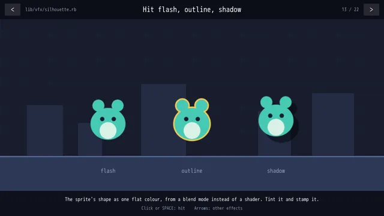

# Hit flash, outline, shadow



- **File:** `mygame/lib/vfx/silhouette.rb` (`Vfx::Silhouette`)
- **Needs:** nothing. Any licence tier, web builds included.
- **Cost:** one small render target per sprite that needs a mask, redrawn each frame it is asked for. An outline is 8 extra sprites.

## What it is

The shape of a sprite in one flat colour. `mask` draws the sprite into a small
render target with a blend mode that keeps its alpha and discards its colours,
leaving it white. That white shape is then tinted and stamped:

- **Hit flash:** over the sprite, for a few frames after a blow.
- **Outline:** eight copies around the sprite, drawn before it. Selection, hover, an enemy seen through a wall.
- **Shadow:** one dark copy beside it.

Other engines do this with a shader; here it is a custom blend mode, so it runs everywhere.

## Use

```ruby
require "lib/vfx/silhouette.rb"

def tick(args)
  args.state.hurt ||= 0.0
  args.state.hurt = 1.0 if args.inputs.keyboard.key_down.space
  hero = { x: 560, y: 280, w: 160, h: 160, path: "lib/vfx/sprites/circle.png", r: 72, g: 202, b: 180 }

  args.outputs.background_color = [40, 44, 70]
  mask = Vfx::Silhouette.mask(args.outputs, hero)
  args.outputs.primitives << Vfx::Silhouette.shadow(mask)
  args.outputs.primitives << Vfx::Silhouette.outline(mask, width: 4, color: [255, 204, 77])
  args.outputs.primitives << hero
  args.outputs.primitives << Vfx::Silhouette.flash(mask, args.state.hurt)
  args.state.hurt = [args.state.hurt - 0.12, 0].max
end
```

## API

| Call | Does |
|---|---|
| `Vfx::Silhouette.mask(outputs, sprite, target: :vfx_silhouette)` | Builds the white shape and returns it as a sprite in the same place |
| `Vfx::Silhouette.flash(mask, strength, color: [255, 255, 255])` | The mask to draw over the sprite. `strength` 1 solid, 0 nothing |
| `Vfx::Silhouette.outline(mask, width: 3, color: [255, 255, 255], alpha: 255)` | Eight stamps to draw before the sprite |
| `Vfx::Silhouette.shadow(mask, dx: 8, dy: -8, color: [0, 0, 0], alpha: 110)` | One stamp to draw before the sprite |

There is no state: keep your own number for the flash and let it fall.

## Notes

- Give each sprite on screen its own `target:`, or they will share one shape.
- One mask serves all three uses in the same frame.
- A flash of 3 to 6 frames is the norm; red or yellow tints read as different kinds of damage.
- The outline is 8 stamps, so corners of a wide outline look slightly faceted. Past about 6 pixels, stamp it twice at two widths.
- Full-screen and rapid flashing can trigger photosensitive seizures; this one is confined to a sprite, but keep it brief.

## Source

The standard flash-white and stamped outline, done elsewhere with a shader
(godotshaders' "Hit flash", raylib's outline example). Written from scratch.
