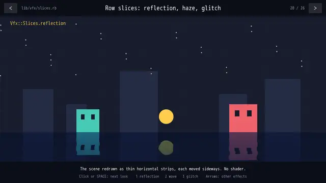

# Row slices: reflection, haze, glitch



- **File:** `mygame/lib/vfx/slices.rb` (`Vfx::Slices`)
- **Needs:** the scene drawn to a render target the size of the screen. Any licence tier, web builds included.
- **Cost:** one sprite per strip: 180 for the whole screen at 4 pixels a strip.

## What it is

The scene redrawn as thin horizontal strips, each moved sideways. Consoles did
this between scanlines, and it needs no shader:

- **Wave:** strips shifted along a sine. Heat haze, underwater, a dream.
- **Reflection:** strips mirrored below a line, rippling and fading with depth. Water.
- **Glitch:** a few thick bands thrown sideways at random.

## Use

```ruby
require "lib/vfx/slices.rb"

def tick(args)
  scene = args.outputs[:scene]
  scene.w = 1280
  scene.h = 720
  scene.background_color = [40, 44, 70]
  scene.primitives << { x: 560, y: 260, w: 160, h: 200, path: :solid, r: 255, g: 204, b: 77 }

  clock = Kernel.tick_count
  args.outputs.primitives << { x: 0, y: 0, w: 1280, h: 720, path: :scene }
  args.outputs.primitives << { x: 0, y: 0, w: 1280, h: 200, path: :solid, r: 16, g: 24, b: 48 }   # the water
  args.outputs.primitives << Vfx::Slices.reflection(:scene, clock, water_y: 200, depth: 200)
  args.outputs.primitives << Vfx::Slices.glitch(:scene, clock.idiv(4)) if args.inputs.keyboard.key_held.space
end
```

## API

| Call | Does |
|---|---|
| `Vfx::Slices.wave(path, clock, amplitude: 6, wavelength: 60, speed: 0.12, x: 0, y: 0, w: 1280, h: 720, slice: 4)` | A rippling copy of one region; draw it over the scene |
| `Vfx::Slices.reflection(path, clock, water_y:, depth:, amplitude: 6, wavelength: 36, speed: 0.1, color: [130, 175, 235], alpha: 170, x: 0, w: 1280, slice: 3)` | What lies above `water_y`, mirrored below it for `depth` pixels |
| `Vfx::Slices.glitch(path, seed, bands: 5, shift: 70, w: 1280, h: 720)` | A few bands thrown sideways; draw them over the scene |
| `Vfx::Slices.sprites(path, x: 0, y: 0, w: 1280, h: 720, slice: 4) { \|row\| ... }` | The strips of a region, each moved by what the block returns |

| Parameter | Meaning |
|---|---|
| `clock` | A frame counter; the ripple travels with it |
| `amplitude` | How far strips move, in pixels |
| `wavelength` | The height of one wave, in pixels |
| `slice` | The height of a strip. Smaller is smoother and costs more |
| `seed` | A whole number. The same seed gives the same bands, so change it every few frames |

There is no state.

## Notes

- The region's rows are read from the same place on the render target, so the target must be the size of the screen and drawn unscaled.
- A wave shifts strips past the region's edges; over a sub-region that shows as a ragged border. Keep amplitudes small there.
- Reflections look best over a dark rectangle the colour of the water, drawn first.
- Combine a glitch with `Vfx::RgbSplit` for the usual look.
- Use `sprites` with your own block for anything else: a wipe that tears, a wobble that grows with a boss's rage.

## Source

Per-scanline offsets, the "raster effects" of 8- and 16-bit consoles;
pixi-filters' ReflectionFilter and GlitchFilter (MIT) show the same looks with
a shader. Written from scratch.
