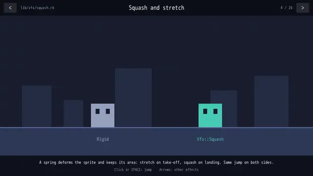

# Squash and stretch



- **File:** `mygame/lib/vfx/squash.rb` (`Vfx::Squash`)
- **Needs:** nothing. Any licence tier, web builds included.
- **Cost:** a few multiplications per body per frame.

## What it is

A sprite flattens when it lands and lengthens when it takes off, and a spring
brings it back with a wobble. Width and height change together so the area
stays the same; that is what makes the thing look soft instead of resized.

One number, `:value`, holds the deformation: above 0 is squashed (wider and
shorter), below 0 is stretched (taller and thinner).

## Use

```ruby
require "lib/vfx/squash.rb"

def tick(args)
  body = args.state.body ||= Vfx::Squash.new
  keys = args.inputs.keyboard.key_down
  Vfx::Squash.squash(body, 0.4) if keys.down     # as on landing
  Vfx::Squash.stretch(body, 0.3) if keys.up      # as on take-off
  Vfx::Squash.pop(body) if keys.space            # swell and settle
  Vfx::Squash.tick(body)

  hero = { x: 600, y: 200, w: 80, h: 80, path: :solid, r: 72, g: 202, b: 180 }
  args.outputs.primitives << Vfx::Squash.apply(body, hero)   # feet stay where they were
end
```

## API

| Call | Does |
|---|---|
| `Vfx::Squash.new(stiffness: 0.14, damping: 0.8)` | Returns the state Hash |
| `Vfx::Squash.squash(body, amount = 0.3)` | Flattens at once. 0.3 a landing, 0.6 a heavy fall |
| `Vfx::Squash.stretch(body, amount = 0.25)` | Lengthens at once. 0.25 a jump, 0.4 a dash |
| `Vfx::Squash.pop(body, strength = 0.12)` | A push: the thing swells and settles. Buttons, pickups |
| `Vfx::Squash.tick(body, time_scale = 1.0)` | Once a frame |
| `Vfx::Squash.scale(body)` | `[width scale, height scale]` |
| `Vfx::Squash.apply(body, sprite, pin_x: 0.5, pin_y: 0.0)` | A copy of the sprite deformed about a fixed point |

| Parameter | Meaning |
|---|---|
| `stiffness` | How hard the spring pulls back. 0.1 lazy, 0.4 snappy |
| `damping` | Speed kept each frame. 0.6 settles at once, 0.9 wobbles for long |
| `pin_x`, `pin_y` | The point that stays put, as a fraction of the sprite: 0.5, 0 is the feet; 0.5, 0.5 the centre |

## Notes

- `apply` expects `x`, `y` to be the bottom-left corner. For a sprite that uses `anchor_x`/`anchor_y`, take `scale` and multiply `w` and `h` yourself.
- Squash along the direction of travel: for something hitting a wall, swap the two scales.
- One state per thing that deforms. They are small.

## Source

The first of Disney's twelve principles of animation, shown for games in
Martin Jonasson and Petri Purho's "Juice it or lose it" (2012). Written from
scratch.
