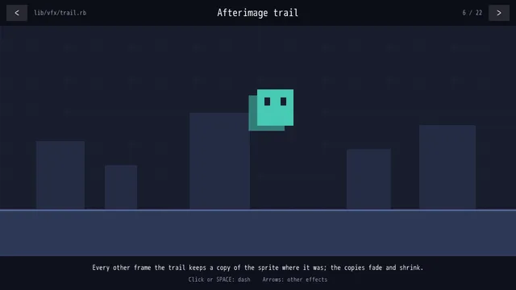

# Afterimage trail



- **File:** `mygame/lib/vfx/trail.rb` (`Vfx::Trail`)
- **Needs:** nothing. Any licence tier, web builds included.
- **Cost:** `life / every` extra sprites per trail (9 with the defaults).

## What it is

Every few frames the trail keeps a copy of a sprite where it was, and the
copies fade out. It reads as speed. Use it for dashes, fast enemies and thrown
things. Also called a ghost trail.

## Use

```ruby
require "lib/vfx/trail.rb"

def tick(args)
  trail = args.state.trail ||= Vfx::Trail.new
  hero = { x: args.inputs.mouse.x - 40, y: args.inputs.mouse.y - 40, w: 80, h: 80,
           path: :solid, r: 72, g: 202, b: 180 }

  Vfx::Trail.tick(trail, hero)                # pass nil instead to stop leaving copies
  args.outputs.primitives << Vfx::Trail.sprites(trail, shrink: 0.3)   # behind the hero
  args.outputs.primitives << hero
end
```

## API

| Call | Does |
|---|---|
| `Vfx::Trail.new(life: 18, every: 2)` | Returns the state Hash |
| `Vfx::Trail.tick(trail, sprite = nil)` | Once a frame. Keeps a copy of `sprite` every `every` frames; with nil the trail dies out |
| `Vfx::Trail.sprites(trail, color: nil, alpha: 150, shrink: 0.0)` | The copies, oldest first |

| Parameter | Meaning |
|---|---|
| `life` | Frames a copy lasts |
| `every` | Frames between copies. 1 is a smear, 4 is separate ghosts |
| `alpha` | Opacity of a fresh copy, up to 255 |
| `color` | `[r, g, b]` to tint every copy; leave out to keep the sprite's own colours |
| `shrink` | 0.5 takes a copy down to half size by the end of its life, about its centre |

## Notes

- The copy keeps whatever the sprite had that frame (animation frame, flip, angle), so an animated hero leaves its poses behind.
- Tinting works best on a white or light sprite; add `blendmode: 2` to the sprite you pass in for a glowing trail.
- `shrink` assumes `x`, `y` is the bottom-left corner.
- A sprite's own `a` carries into its copies, so a half-transparent sprite leaves fainter ones.
- `life` and `every` are at least 1.

## Source

HaxeFlixel's `FlxTrail` (flixel-addons, MIT). Written from scratch.
