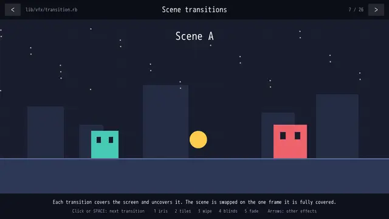

# Scene transitions



- **File:** `mygame/lib/vfx/transition.rb` (`Vfx::Transition`)
- **Needs:** `sprites/hole.png` beside the file, for the iris only. Any licence tier, web builds included.
- **Cost:** 1 to 5 rectangles; `:tiles` draws up to 144.

## What it is

Five ways to get from one scene to another: `:fade`, `:wipe`, `:iris`,
`:tiles` and `:blinds`. Each covers the screen and then uncovers it. On the
single frame the screen is fully covered, `midpoint?` is true; swap the scene
there and the change is hidden.

## Use

```ruby
require "lib/vfx/transition.rb"

def tick(args)
  transition = args.state.transition ||= Vfx::Transition.new
  args.state.night ||= false

  if args.inputs.keyboard.key_down.space && !Vfx::Transition.active?(transition)
    Vfx::Transition.start(transition, :iris, x: 640, y: 360)
  end
  Vfx::Transition.tick(transition)
  args.state.night = !args.state.night if Vfx::Transition.midpoint?(transition)

  args.outputs.background_color = args.state.night ? [20, 22, 50] : [120, 170, 220]
  args.outputs.primitives << Vfx::Transition.overlay(transition)   # last, over everything
end
```

## API

| Call | Does |
|---|---|
| `Vfx::Transition.new` | Returns the state Hash |
| `Vfx::Transition.start(transition, kind, frames: 50, color: [0, 0, 0], x: nil, y: nil)` | Starts one. `frames` is the whole length, 2 at least; `x`, `y` is where the iris closes, the middle of the screen if left out. An unknown `kind` raises `ArgumentError` |
| `Vfx::Transition.tick(transition)` | Once a frame |
| `Vfx::Transition.active?(transition)` | true while one is running |
| `Vfx::Transition.midpoint?(transition)` | true on the one frame the screen is fully covered |
| `Vfx::Transition.cover(transition)` | 0 to 1 and back to 0 |
| `Vfx::Transition.overlay(transition, w: 1280, h: 720)` | The shapes to draw; empty when idle |
| `Vfx::Transition::KINDS` | `[:fade, :wipe, :iris, :tiles, :blinds]` |

| Kind | Looks like |
|---|---|
| `:fade` | The whole screen goes to the colour and back |
| `:wipe` | A curtain enters from the left and leaves to the right |
| `:iris` | A round hole closes on a point, then opens again |
| `:tiles` | Squares grow from the bottom-left corner until they meet |
| `:blinds` | Horizontal bars thicken until they meet |

## Notes

- Close the iris on the hero or on the door just used: pass their position as `x`, `y`.
- Ignore input, or check `active?`, while a transition runs, or a second `start` restarts it halfway.
- To add a kind, add a `when` in `overlay` that returns rectangles for a given `cover`.

## Source

HaxeFlixel's flixel-addons transitions and Nez's `Graphics/Transitions` (both
MIT) for the set of shapes. Written from scratch.
