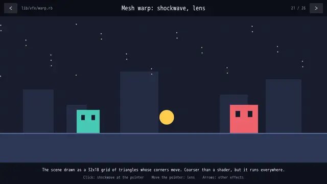

# Mesh warp: shockwave, lens



- **File:** `mygame/lib/vfx/warp.rb` (`Vfx::Warp`)
- **Needs:** the scene drawn to a render target the size of the screen. Any licence tier, web builds included.
- **Cost:** two triangles per grid cell, built in Ruby each frame: 1,152 for the default 32x18 grid. Use it while an effect lasts, not always.

## What it is

The scene drawn as a grid of small triangles instead of one rectangle. Each
corner of the grid can be moved, and the picture stretches to follow. Move the
corners around a growing ring and it is a shockwave; push them away from a
point and it is a lens.

It is coarser than a shader: the bend is only as fine as the grid. In return
it runs on every licence tier and in the browser.

## Use

```ruby
require "lib/vfx/warp.rb"

def tick(args)
  scene = args.outputs[:scene]
  scene.w = 1280
  scene.h = 720
  scene.background_color = [40, 44, 70]
  12.times { |i| scene.primitives << { x: i * 110, y: 0, w: 4, h: 720, path: :solid, r: 255, g: 255, b: 255, a: 60 } }

  mouse = args.inputs.mouse
  args.state.wave = { x: mouse.x, y: mouse.y, radius: 0 } if mouse.click
  wave = args.state.wave
  if wave && wave[:radius] < 900
    wave[:radius] += 14
    args.outputs.primitives << Vfx::Warp.shockwave(:scene, wave[:x], wave[:y], wave[:radius])
  else
    args.outputs.primitives << Vfx::Warp.bulge(:scene, mouse.x, mouse.y, 220)
  end
end
```

Draw the warp instead of the scene, not over it.

## API

| Call | Does |
|---|---|
| `Vfx::Warp.shockwave(path, x, y, radius, width: 90, amplitude: 26, columns: 32, rows: 18, w: 1280, h: 720)` | A ring at `radius` that pushes the picture outwards by `amplitude` pixels |
| `Vfx::Warp.bulge(path, x, y, radius, strength: 0.5, columns: 32, rows: 18, w: 1280, h: 720)` | A lens. Above 0 swells, below 0 pinches; keep within -0.8 to 0.8 |
| `Vfx::Warp.sprites(path, columns: 32, rows: 18, w: 1280, h: 720) { \|x, y\| [dx, dy] }` | The grid, each corner moved by what the block returns |

There is no state: grow the radius yourself.

## Notes

- Corners on the outer edge never move, so the picture's border stays closed.
- Fade a shockwave's `amplitude` as its radius grows, as the gallery demo does.
- A finer grid bends more smoothly and costs more: 48x27 is 2,592 triangles.
- Straight lines show the grid most. Busy scenes hide it.
- Use `sprites` with your own block for a wobble, a ripple, a screen that melts.

## Source

Grid deformation, as in cocos2d's grid actions (Ripple3D, Lens3D);
pixi-filters' ShockwaveFilter (MIT) shows the look with a shader. Written from
scratch.
