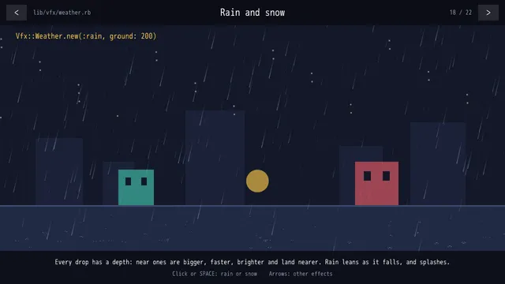

# Rain and snow



- **File:** `mygame/lib/vfx/weather.rb` (`Vfx::Weather`)
- **Needs:** beside the file, `sprites/streak.png` and `ring.png` for rain, `circle.png` for snow. Any licence tier, web builds included.
- **Cost:** one sprite per drop (300 by default), each moved in Ruby every frame, plus one per splash on screen.

## What it is

Rain or snow falling at several depths. Every drop has a depth: near ones are
larger, faster and brighter, far ones small, slow and faint, which makes a
flat picture look deep.

Rain is drawn as soft streaks, brightest at the drop and fading up the tail,
turned to point the way they travel. Give it a ground and each drop lands on
it, near drops lowest on the screen, and leaves a small ring that widens and
fades.

## Use

```ruby
require "lib/vfx/weather.rb"

def tick(args)
  weather = args.state.weather ||= Vfx::Weather.new(:rain, ground: 200)
  args.state.weather = Vfx::Weather.new(:snow, ground: 200) if args.inputs.keyboard.key_down.space
  Vfx::Weather.tick(weather)

  args.outputs.background_color = [22, 26, 44]
  args.outputs.primitives << { x: 0, y: 0, w: 1280, h: 200, path: :solid, r: 34, g: 42, b: 68 }   # the ground
  args.outputs.primitives << Vfx::Weather.sprites(weather)
end
```

## API

| Call | Does |
|---|---|
| `Vfx::Weather.new(kind = :rain, count: 300, w: 1280, h: 720, ground: nil, ground_depth: 120, **changes)` | Returns the state Hash. `kind` is `:rain` or `:snow`; anything else raises `ArgumentError` |
| `Vfx::Weather.tick(weather, time_scale = 1.0)` | Once a frame |
| `Vfx::Weather.sprites(weather)` | One sprite per drop, then one per splash |
| `Vfx::Weather.lean(weather)` | The angle rain is drawn at, in degrees |
| `Vfx::Weather.landing(weather, depth)` | The y at which a drop of that depth lands; nil without a ground |
| `Vfx::Weather::KINDS` | The settings of each kind |

| Parameter | Meaning |
|---|---|
| `ground` | The y of the ground's far edge. Left out, drops fall through the whole screen and there are no splashes |
| `ground_depth` | How far below `ground` the nearest drops land, in pixels |

Any setting of a kind can be changed when creating it, or afterwards in the Hash:

| Setting | Rain | Snow | Meaning |
|---|---|---|---|
| `fall` | 30.0 | 2.4 | Pixels per frame downwards, for the nearest drops |
| `wind` | -7.0 | -0.6 | Pixels per frame sideways; negative blows left |
| `sway` | 0.0 | 1.0 | How far a drop wanders from side to side |
| `wide`, `long` | 3, 70 | 7, 7 | Size of the nearest drops |
| `alpha` | 130 | 235 | Opacity of the nearest drops |
| `color` | `[190, 215, 255]` | `[255, 255, 255]` | `[r, g, b]` |
| `path` | the streak | the circle | The picture of one drop, drawn upright |

## Notes

- A storm is `Vfx::Weather.new(:rain, count: 500, wind: -16)`; a drizzle is `count: 120, fall: 18, long: 40, alpha: 90`.
- Change `weather[:wind]` over time for gusts; the streaks turn with it.
- Rain reads best over a dimmed scene: draw a dark blue rectangle at a third opacity between the scene and the rain.
- Draw far drops behind the characters and near ones in front for more depth: split `sprites` by size.
- Snow settles without a splash. For snow that piles up, stamp it into `Vfx::Decals` where it lands.
- With many drops the per-drop Ruby work adds up; measure before going far past 500.

## Source

Layered particle fields, velocity-aligned streaks and ground splashes, as in
most engines' rain tutorials. Written from scratch.
